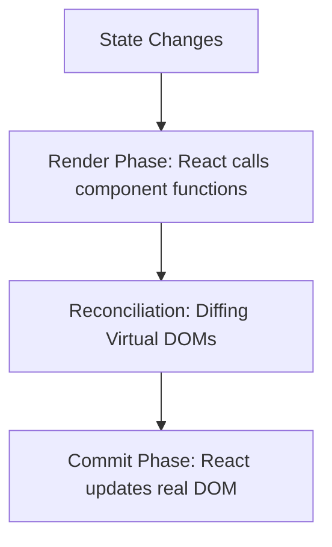
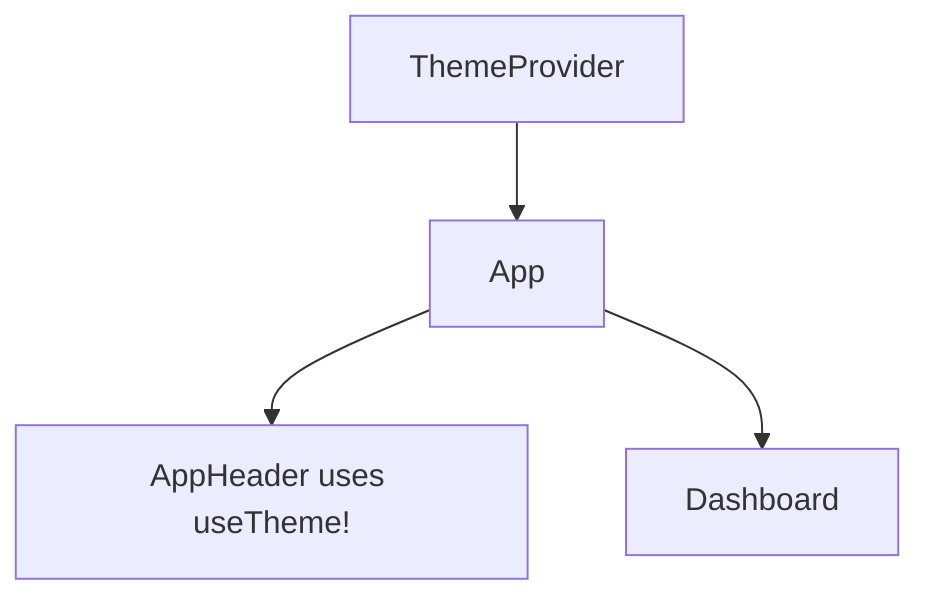

# FlowState: The Complete React Learning Guide

Welcome to the ultimate learning guide for **FlowState**, your personal productivity dashboard built with React. This guide is a living document—it mirrors the actual source code of your project.

## Table of Contents
1. [Project Overview](#section-1-project-overview)
2. [React Rendering and Component Architecture](#section-2-react-rendering-and-component-architecture)
3. [Props and One-Way Data Flow](#section-3-props-and-one-way-data-flow)
4. [useState and State Management](#section-4-usestate-and-state-management)
5. [useEffect and External Synchronization](#section-5-useeffect-and-external-synchronization)
6. [useRef](#section-6-useref)
7. [Context API](#section-7-context-api)
8. [useReducer](#section-8-usereducer)
9. [Rendering Performance and Correctness](#section-9-rendering-performance-and-correctness)
10. [Redux Toolkit (RTK) & Global State](#section-10-redux-toolkit-rtk--global-state)
11. [Practical Learning Roadmap](#practical-learning-roadmap)
12. [Debugging Exercises](#debugging-exercises)
13. [Interview Preparation Bank](#interview-preparation-bank)
14. [Source Code Reference Index](#source-code-reference-index)

---

## Section 1: Project Overview
**FlowState** is a productivity dashboard combining project management, task tracking, and a Pomodoro-style focus timer. It is built using **React 19, JSX, Vite, Redux Toolkit, useReducer, Context API, and plain CSS** to help you master state management from simple primitives to enterprise architecture.

### Project Structure
```text
src/
├── components/
│   ├── AppHeader.jsx              # Top navigation, theme toggle, active tab
│   ├── Sidebar.jsx                # Left navigation menu with Redux badges
│   ├── Dashboard.jsx              # Main content area with Redux filters & task lists
│   ├── FocusTimer.jsx             # Pomodoro timer (useReducer state machine)
│   ├── StateArchitectureGuide.jsx # Interactive state visualizer
│   ├── StatCard.jsx               # Reusable card for statistics
│   ├── ProjectCard.jsx            # Project card with progress bar (Redux entity)
│   └── TaskPreview.jsx            # Row displaying task with toggle/delete
├── context/
│   ├── TaskContext.jsx            # Task domain state managed via useReducer
│   └── ThemeContext.jsx           # Global dark/light theme via Context API
├── store/
│   ├── index.js                   # Redux Toolkit store (configureStore)
│   └── slices/
│       ├── projectsSlice.js       # Projects state, CRUD, & tasks sync
│       └── filtersSlice.js        # Active tab, search, priority filter
├── data/
│   └── initialData.js             # Fallback sample data
├── App.jsx                        # Layout composition
├── main.jsx                       # Redux Provider & Context Providers entry
└── index.css                      # Global styles and theme variables
```

### Installation and Running
- **Install:** `npm install`
- **Run dev server:** `npm run dev`
- **Build:** `npm run build`
- **Lint:** `npm run lint`

---

## Section 2: React Rendering and Component Architecture

### What it is
React is a JavaScript library for building user interfaces using **Components**—reusable pieces of UI. **JSX** is a syntax extension that looks like HTML but compiles into JavaScript.

### Why it exists
Building complex UIs with vanilla JS and DOM manipulation (`document.createElement`) is fragile and hard to scale. React introduces a **Virtual DOM** and a declarative rendering model.

### How it works
1. **Render Phase:** React calls your component functions. They return JSX (a description of what the UI *should* look like).
2. **Reconciliation:** React compares the new JSX with the previous render's Virtual DOM.
3. **Commit Phase:** React updates only the specific parts of the real browser DOM that changed.



### FlowState Example
`App.jsx` composes `Sidebar`, `AppHeader`, and `Dashboard`.

### Code Example
```jsx
// src/App.jsx
import React, { useState } from 'react';
import Sidebar from './components/Sidebar';
import Dashboard from './components/Dashboard';

function App() {
  return (
    <div className="app-container">
      <Sidebar />
      <Dashboard projects={projects} />
    </div>
  );
}
```

### Common Mistakes
- **Changing normal variables:** Changing a `let` variable does not trigger a render. React only re-renders when state or props change.
- **Strict Mode:** In development, React renders components *twice* to detect side-effect bugs. Don't be alarmed by double `console.log`s!

---

## Section 3: Props and One-Way Data Flow

### What it is
Props (properties) are how React components talk to each other. They flow in one direction: **Parent to Child**.

### Why it exists
One-way data flow makes applications predictable. You always know where data comes from.

### FlowState Example
`Dashboard` passes data to `StatCard`.

### Code Example
```jsx
// src/components/Dashboard.jsx
<StatCard title="Completed Tasks" value={actualCompletedTasks} />

// src/components/StatCard.jsx
const StatCard = memo(({ title, value, unit }) => {
  return <div className="stat-value">{value} {unit}</div>;
});
```

### Common Mistakes
- **Mutating Props:** Props are read-only! Never do `props.title = "New Title"`.
- **Prop Drilling:** Passing props through 5 levels of components just to get it to the bottom. (We solve this with Context later).

---

## Section 4: useState and State Management

### What it is
`useState` is a Hook that gives a component memory. 

### Why it exists
When a user interacts with the app (typing a task, clicking "Delete"), the app needs to remember the change and update the UI.

### FlowState Example
`Dashboard.jsx` remembers what you type in the new task input.

### Code Example
```jsx
// src/components/Dashboard.jsx
const [newTaskTitle, setNewTaskTitle] = useState('');

<input 
  value={newTaskTitle} 
  onChange={(e) => setNewTaskTitle(e.target.value)} 
/>
```

### Common Mistakes
- **Direct Mutation:** `state.push(item)` is WRONG. You must do `setState([...state, item])` (Immutable update).
- **Stale Closures:** If new state depends on old state, use functional updates: `setCount(prev => prev + 1)`.

---

## Section 5: useEffect and External Synchronization

### What it is
`useEffect` lets a component synchronize with external systems (APIs, timers, the DOM, localStorage).

### FlowState Example
Saving the dark mode preference to `localStorage`. Managing the Focus Timer interval.

### Code Example
```jsx
// src/components/Dashboard.jsx
useEffect(() => {
  let intervalId;
  if (timerActive && timeLeft > 0) {
    intervalId = setInterval(() => setTimeLeft(prev => prev - 1), 1000);
  }
  return () => clearInterval(intervalId); // CLEANUP!
}, [timerActive, timeLeft]); // DEPENDENCIES
```

### Common Mistakes
- **Missing Cleanup:** Forgetting `clearInterval` leads to memory leaks and runaway timers.
- **Infinite Loops:** Updating state inside an effect without a dependency array.

---

## Section 6: useRef

### What it is
`useRef` is a box for holding mutable values. Changing it does **not** trigger a re-render.

### FlowState Example
Focusing the task input after form submission.

### Code Example
```jsx
// src/components/Dashboard.jsx
const taskInputRef = useRef(null);

const handleFormSubmit = (e) => {
  // ... add task ...
  taskInputRef.current.focus(); 
};
```

---

## Section 7: Context API

### What it is
Context lets you broadcast data to any component in the tree without passing props down manually.

### FlowState Example
`ThemeContext` broadcasts `isDark` to `AppHeader` and `index.css`.



---

## Section 8: useReducer

### What it is
`useReducer` is an alternative to `useState` built directly into React for managing complex or interdependent state transitions. Instead of directly calling state setters, components **`dispatch`** an action object (`{ type: 'TASK_ADDED', payload: ... }`), and a **pure reducer function** calculates the new state.

FlowState implements `useReducer` in two distinct, real-world patterns:

#### Pattern A: Domain State with Context (`src/context/TaskContext.jsx`)
Manages task collection operations (create, toggle status, delete, clear completed) with localStorage persistence and lazy initialization.

```jsx
// src/context/TaskContext.jsx
export const taskReducer = (state, action) => {
  switch (action.type) {
    case 'TASK_ADDED':
      return [{ ...action.payload, completed: false }, ...state];
    case 'TASK_TOGGLED':
      return state.map(task => 
        task.id === action.payload ? { ...task, completed: !task.completed } : task
      );
    case 'TASK_DELETED':
      return state.filter(task => task.id !== action.payload);
    case 'TASKS_CLEAR_COMPLETED':
      return state.filter(task => !task.completed);
    default:
      return state;
  }
};
```

#### Pattern B: Local Finite State Machine (`src/components/FocusTimer.jsx`)
The Pomodoro Focus Timer manages interrelated variables (`mode`, `status`, `timeLeft`, `completedSessions`). Managing these with multiple `useState` hooks easily causes race conditions. With `timerReducer`, every timer tick and mode switch is atomic:

```jsx
// src/components/FocusTimer.jsx
export const timerReducer = (state, action) => {
  switch (action.type) {
    case 'START': return { ...state, status: 'running' };
    case 'PAUSE': return { ...state, status: 'paused' };
    case 'RESET': return { ...state, status: 'idle', timeLeft: DURATIONS[state.mode] };
    case 'SET_MODE': return { ...state, mode: action.payload, status: 'idle', timeLeft: DURATIONS[action.payload] };
    case 'TICK':
      if (state.timeLeft <= 1) {
        return {
          ...state,
          status: 'idle',
          mode: state.mode === 'work' ? 'shortBreak' : 'work',
          timeLeft: state.mode === 'work' ? DURATIONS.shortBreak : DURATIONS.work,
          completedSessions: state.mode === 'work' ? state.completedSessions + 1 : state.completedSessions
        };
      }
      return { ...state, timeLeft: state.timeLeft - 1 };
    default: return state;
  }
};
```

---

## Section 9: Rendering Performance and Correctness

### What it is
React is fast, but re-rendering huge lists on every keystroke is slow. We use `React.memo` (cache components), `useMemo` (cache calculations), and `useCallback` (cache functions) to optimize.

### FlowState Example
`TaskPreview` and `ProjectCard` are wrapped in `React.memo`. The task filter calculation and stats calculations are wrapped in `useMemo`. Handlers passed as props use `useCallback`.

---

## Section 10: Redux Toolkit (RTK) & Global State

### What it is
**Redux Toolkit (RTK)** is the official, opinionated standard for writing modern Redux logic. It provides:
1. `configureStore`: Sets up a standardized store with Redux DevTools and immutability checks automatically.
2. `createSlice`: Combines actions and reducers using Immer (allowing "mutating" syntax that writes immutable updates).
3. `useSelector` & `useDispatch`: React hooks from `react-redux` to subscribe to and dispatch state changes.

### Why Redux Toolkit in FlowState?
While `TaskContext` handles the Task domain with `useReducer`, **Projects** and **Global Filters / Navigation** are cross-cutting concerns accessed by the Sidebar, AppHeader, and Dashboard.

### Store Architecture in FlowState
```text
src/store/
├── index.js               # configureStore({ reducer: { projects, filters } })
└── slices/
    ├── projectsSlice.js   # addProject, deleteProject, syncProjectStats
    └── filtersSlice.js    # setSelectedProjectId, setPriorityFilter, setSearchQuery, setActiveTab
```

### FlowState Redux Slices:
1. **`projectsSlice`**:
   - Manages the project catalog.
   - `syncProjectStats(tasks)`: Demonstrates cross-system synergy—reads tasks produced by `useReducer` and updates project completion percentages!
2. **`filtersSlice`**:
   - Manages active navigation tabs in `Sidebar` and search/priority filter criteria across the application.

### State Comparison Matrix

| Feature | `useState` | `useReducer` | Redux Toolkit |
| :--- | :--- | :--- | :--- |
| **Scope** | Single component | Component or Context | Entire Application |
| **Complexity** | Simple primitives / independent values | Coupled, multi-step state machines | Enterprise, multi-slice domains |
| **Performance** | Triggers render on change | Triggers render on change | Selector-level re-render optimization |
| **DevTools** | React DevTools | React DevTools | Redux DevTools (Time-Travel Debugging) |
| **Use in FlowState** | Text inputs (`newTaskTitle`, `isModalOpen`) | Tasks collection & Pomodoro Timer | Projects catalog & Global UI Filters |

---

## Practical Learning Roadmap

1. **Component architecture:** Create `App`, `Sidebar`, `Dashboard`. (Completed)
2. **Props:** Pass `sampleTasks` to `TaskPreview`. (Completed)
3. **useState:** Add a text input to create tasks. (Completed)
4. **State sharing:** Lift state to `App.jsx`. (Completed)
5. **useEffect:** Save to `localStorage`. (Completed)
6. **useRef:** Focus the input field and preserve interval IDs. (Completed)
7. **Context API:** Implement Dark Mode theme provider. (Completed)
8. **useReducer:** Implement task domain reducer and timer state machine. (Completed)
9. **Performance:** Apply `React.memo`, `useMemo`, and `useCallback`. (Completed)
10. **Redux Toolkit:** Implement centralized Redux store, projects slice, filters slice, and cross-state sync. (Completed)

---

## Debugging Exercises

*(Hint: Try to solve these before looking at the answers!)*

**Exercise 1: The UI won't update!**
```jsx
let count = 0;
const increment = () => { count += 1; };
return <button onClick={increment}>{count}</button>
```
*Symptom:* Clicking the button does nothing.
*Solution:* React only re-renders on state changes. Use `const [count, setCount] = useState(0)`.

**Exercise 2: The infinite loop**
```jsx
useEffect(() => {
  setTasks(fetchTasks());
}); // No dependency array!
```
*Symptom:* Browser freezes/crashes.
*Solution:* Add `[]` as the dependency array to run only on mount.

**Exercise 3: The runaway timer**
```jsx
useEffect(() => {
  setInterval(() => setTimeLeft(prev => prev - 1), 1000);
}, [timerActive]);
```
*Symptom:* The timer ticks down faster and faster every time you pause and start.
*Solution:* You forgot the cleanup function! `return () => clearInterval(id);`.


**Exercise 4: Mutating state directly**
```jsx
const handleAdd = () => {
  tasks.push(newTask);
  setTasks(tasks);
};
```
*Symptom:* The new task isn't rendered on the screen.
*Hint:* React checks if the array reference changed.
*Solution:* `setTasks([...tasks, newTask]);` (Immutable update).

**Exercise 5: Multiple state updates in one handler**
```jsx
const incrementTwice = () => {
  setCount(count + 1);
  setCount(count + 1);
};
```
*Symptom:* The count only goes up by 1 instead of 2.
*Hint:* `count` is a snapshot of the state during this render.
*Solution:* Use functional updates: `setCount(prev => prev + 1); setCount(prev => prev + 1);`

**Exercise 6: Missing React keys**
```jsx
{tasks.map(task => <TaskPreview title={task.title} />)}
```
*Symptom:* Warning in console: "Each child in a list should have a unique 'key' prop."
*Hint:* React uses keys to track list items.
*Solution:* `<TaskPreview key={task.id} title={task.title} />`

**Exercise 7: Array indexes as keys**
```jsx
{tasks.map((task, index) => <TaskPreview key={index} />)}
```
*Symptom:* Deleting task #2 causes task #3 to take its state and bugs occur.
*Hint:* When the array shifts, indexes change.
*Solution:* Use a stable, unique ID like `task.id`.

**Exercise 8: Incorrect effect dependencies**
```jsx
useEffect(() => {
  document.title = `Tasks: ${tasks.length}`;
}, []);
```
*Symptom:* The document title updates on mount, but never changes when tasks are added.
*Hint:* The effect relies on `tasks`.
*Solution:* Add `tasks` to the dependency array: `[tasks]`.

**Exercise 9: Stale closures in intervals**
```jsx
useEffect(() => {
  setInterval(() => {
    console.log("Time left:", timeLeft);
  }, 1000);
}, []);
```
*Symptom:* It always logs "Time left: 1500" even as the timer ticks down.
*Hint:* The effect only ran once, capturing the initial value of `timeLeft`.
*Solution:* Use a functional state update or add `timeLeft` to the dependency array (and cleanup the interval!).

**Exercise 10: Missing Context Provider**
```jsx
const { isDark } = useTheme(); // Inside AppHeader
```
*Symptom:* `isDark` is undefined, app crashes.
*Hint:* Where is the broadcast coming from?
*Solution:* Ensure `AppHeader` is nested inside `<ThemeProvider>`.

**Exercise 11: Mutating state in a reducer**
```jsx
case 'TASK_COMPLETED':
  const task = state.find(t => t.id === action.payload);
  task.completed = true;
  return state;
```
*Symptom:* UI doesn't update after completing a task.
*Hint:* Reducers must be pure and return new objects.
*Solution:* Use `.map()` to return a new array with the modified object.

**Exercise 12: Missing default case in reducer**
```jsx
switch (action.type) {
  case 'ADD': return [...state, action.payload];
}
```
*Symptom:* Dispatching an unknown action destroys the state (turns it undefined).
*Hint:* What does the function return if the type doesn't match?
*Solution:* Add `default: return state;`.

**Exercise 13: Breaking React.memo**
```jsx
<ProjectCard onSelect={() => console.log('selected')} />
```
*Symptom:* ProjectCard re-renders every time the parent renders, despite `React.memo`.
*Hint:* Inline functions are created fresh every render.
*Solution:* Wrap the function in `useCallback`.

**Exercise 14: Over-memoizing**
```jsx
const headerText = useMemo(() => "Hello World", []);
```
*Symptom:* Code works, but is overly complex.
*Hint:* Memoization has overhead.
*Solution:* Just use `const headerText = "Hello World";`.

**Exercise 15: Modifying props**
```jsx
const TaskPreview = ({ title }) => {
  title = title.toUpperCase();
  // ...
};
```
*Symptom:* Code might work, but violates React rules and can cause bugs in Strict Mode.
*Hint:* Props are strictly read-only.
*Solution:* Create a new variable: `const displayTitle = title.toUpperCase();`


---

## Interview Preparation Bank

### Beginner
1. **What is the Virtual DOM?** A lightweight JavaScript representation of the real DOM. React diffs it to find the minimum number of real DOM updates.
2. **What is JSX?** A syntax extension for JavaScript that compiles to `React.createElement` calls.
3. **What are props?** Read-only data passed from parent to child components.


10. **What is prop drilling?** Passing props through multiple layers of components that don't need the data, just to reach a deeply nested child.
11. **How does the Context API solve prop drilling?** It provides a way to broadcast data directly to deeply nested components without passing it manually.
12. **Why should you avoid putting all state into a single global Context?** Every time the Context value changes, every consuming component re-renders. High-frequency updates can cause massive performance issues.
13. **What is a controlled component?** A form input whose `value` is driven by React state, rather than the DOM's internal state.
14. **What is the purpose of the dependency array in `useEffect`?** It tells React exactly which variables to watch. If they haven't changed, the effect is skipped.
15. **What happens if you leave out the dependency array entirely?** The effect runs after *every single render*.
16. **Why is it important to return a cleanup function from `useEffect`?** To remove event listeners, intervals, or cancel network requests before the component unmounts or the effect re-runs.
17. **What is the difference between `useState` and `useRef`?** Updating state triggers a re-render; updating a ref does not.
18. **Can you access a ref during the render phase?** No, reading or writing `ref.current` during render makes your component impure. Do it in effects or event handlers.
19. **What does `React.memo` do?** It wraps a component and skips re-rendering it if its props haven't changed (using shallow comparison).
20. **Why do we need `useCallback`?** To cache function definitions between renders, so they don't break the optimization of child components wrapped in `React.memo`.
21. **What is the difference between `useMemo` and `useCallback`?** `useMemo` caches the result of calling a function; `useCallback` caches the function itself.
22. **What is a reducer?** A pure function that takes the current state and an action, and returns the next state.
23. **What is an action in the context of `useReducer`?** An object describing what happened, typically containing a `type` string and a `payload`.
24. **Why must reducers be pure functions?** So React can predictably manage state transitions and implement features like Time Travel Debugging in Redux.
25. **What is "lifting state up"?** Moving state to the closest common ancestor of the components that need it.
26. **What is derived state?** Values calculated on the fly during render from existing state or props, rather than being stored in state themselves (e.g., `completedTasksCount`).
27. **Why shouldn't you duplicate props into state?** If the parent's props change, the child's state won't automatically update, leading to stale data.
28. **How does React batch state updates?** It queues multiple `setState` calls during an event handler and executes them together in a single re-render.
29. **What is Strict Mode?** A development-only tool that highlights potential problems by intentionally double-invoking renders, effects, and reducers.
30. **What is the difference between client state and server state?** Client state is UI-specific (modal open/closed); server state is data persisted on a backend (user profile).
31. **When should you use Redux vs Context API?** Context is for low-frequency updates (theme, auth). Redux is for complex, high-frequency, heavily interdependent state.
32. **What is a side effect?** Any operation that affects things outside the component (fetching data, mutating the DOM directly, setting a timer).
33. **Why do we need keys in React lists?** To help React identify which items have changed, are added, or are removed during reconciliation.
34. **What happens if you use `Math.random()` as a key?** React will think every item is new on every render, destroying and recreating the DOM nodes entirely (terrible performance).
35. **What is a Custom Hook?** A JavaScript function starting with "use" that lets you extract and reuse stateful logic (like `useTheme`).
36. **Can a Custom Hook return JSX?** No, that would make it a Component. Hooks return data or functions.
37. **What is the "Rules of Hooks"?** Only call Hooks at the top level of a component. Don't call them inside loops, conditions, or nested functions.
38. **How would you fetch data in React?** Typically inside a `useEffect` with an empty dependency array, or using a library like React Query.
39. **What is a "pure component" in React?** A component that always renders the same UI given the same props and state, without side effects.
40. **How does FlowState's architecture currently handle data persistence?** It synchronizes the `tasks` reducer state with the browser's `localStorage` via a `useEffect` inside `TaskProvider`.
\n### Intermediate
4. **Why shouldn't you mutate state directly?** React relies on object identity (reference equality) to detect changes. If you mutate an array, its memory address hasn't changed, so React bails out of rendering.
5. **What is a stale closure?** When a function inside `useEffect` references a state variable from an old render because the dependency array was missing that variable.
6. **How does `useReducer` differ from `useState`?** `useReducer` centralizes complex state logic in a pure function outside the component, taking an action and returning a new state.

### Advanced
7. **Explain React Batching.** React groups multiple state updates into a single re-render for better performance.
8. **When would you use `useLayoutEffect` instead of `useEffect`?** When you need to read the DOM and synchronously re-render *before* the browser paints (e.g., measuring tooltips).
9. **Why is using array index as a `key` dangerous?** If the list is reordered or items are deleted, React will reuse components for the wrong items, leading to UI bugs and lost state.

---

## Source Code Reference Index

| Concept | File | Implementation | Status |
|---|---|---|---|
| Props | `StatCard.jsx` | `title`, `value` | Implemented |
| useState | `Dashboard.jsx` | `newTaskTitle` | Implemented |
| useEffect | `TaskContext.jsx` | Saving to localStorage | Implemented |
| useRef | `Dashboard.jsx` | `taskInputRef`, `intervalRef` | Implemented |
| Context API | `ThemeContext.jsx` | `ThemeProvider`, `useTheme` | Implemented |
| useReducer | `TaskContext.jsx` | `taskReducer` | Implemented |
| React.memo | `TaskPreview.jsx` | `memo(...)` | Implemented |

---
*Generated for FlowState. Keep building!*
